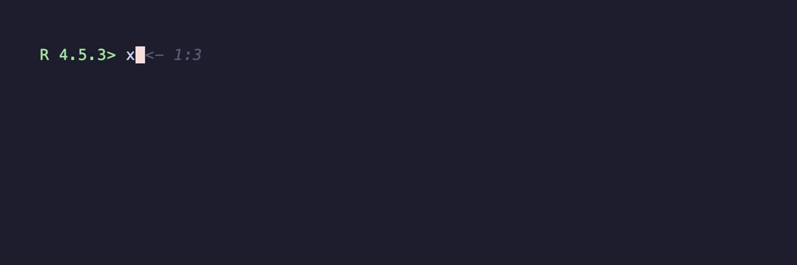
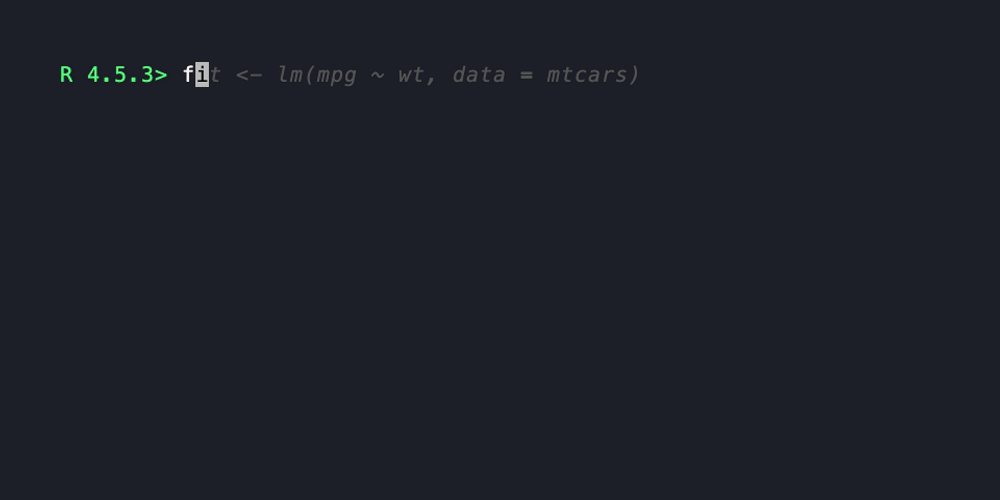

```{r, include = FALSE}
knitr::opts_chunk$set(
  collapse = TRUE,
  comment  = "#>",
  fig.path = "man/figures/README-"
)
```

# vhsR

<!-- badges: start -->
<!-- badges: end -->

Animated GIF demos of R code, generated by an R one-liner. Wraps
[charmbracelet/vhs](https://github.com/charmbracelet/vhs).

## Installation

```r
# install.packages("pak")
pak::pak("cynkra/vhsR")
```

`vhs` itself plus its runtime dependencies (`ttyd`, `ffmpeg`) are downloaded
into a per-user cache on first use:

```r
library(vhsR)
vhsr_install()   # one-time setup
vhsr_doctor()    # confirms everything is in place
```

On macOS, `vhsr_install()` will print a `brew install` line for `ttyd` and
`ffmpeg` (those have no usable upstream binaries for macOS); on Linux and
Windows everything is downloaded automatically.

## Usage

```r
record_demo({
  x <- 1:5
  mean(x)
  head(cars, 3)
}, output = "demo.gif")
```

That writes `demo.gif` next to your working directory. The GIF shows the
code being typed at a real R prompt, with output appearing as it would in
an interactive session.



### Styling

```r
record_demo(
  {
    fit <- lm(mpg ~ wt, data = mtcars)
    summary(fit)$coefficients
  },
  output         = "fit.gif",
  width          = 1000,
  height         = 500,
  font_size      = 20,
  theme          = "Dracula",
  typing_speed   = "100ms",
  playback_speed = 1.25
)
```



### Pacing

Four extra timing args control how the recording feels:

- `start_pause` — sleep between R startup and the first typed line
  (default `"800ms"`).
- `end_pause` — sleep before the (hidden) `q()` exit (default `"500ms"`).
- `paragraph_pause` — when set, blank lines in `expr` become a sleep of
  this duration instead of being typed.
- `typing_speed_jitter` — numeric in `[0, 1]`; per-line typing speed is
  sampled within `±jitter` of `typing_speed` so the recording feels less
  mechanical. Call `set.seed()` first for reproducibility.

```r
record_demo(
  {
    x <- 1:5
    mean(x)

    head(cars, 3)
  },
  output              = "paced.gif",
  paragraph_pause     = "1s",
  typing_speed_jitter = 0.3
)
```

### Recording from a script file

If the demo lives in a `.R` file, point at it directly:

```r
record_demo_file("examples/demo.R", output = "demo.gif")
```

Equivalent to inlining the file's contents in `record_demo()`. Syntax
errors are caught up-front with a pointer to the file path.

### Single-frame screenshot

For static documentation — prompt, code, and output in a PNG instead of
a GIF:

```r
record_demo_screenshot(
  {
    fit <- lm(mpg ~ wt, data = mtcars)
    summary(fit)$coefficients
  },
  output = "fit.png"
)
```

By default the screenshot is taken after the last typed line. Pass
`at = "after:N"` (1-indexed) to capture after a specific line.

### Knitr / Rmd chunks

vhsR registers a `vhsr` knitr engine on package load, so you can drop a
chunk into a vignette, `README.Rmd`, or pkgdown article:

````
```{vhsr, output="man/figures/demo.gif", height=400}
x <- 1:5
mean(x)
head(cars, 3)
```
````

The chunk records a GIF at `output=` and inserts the corresponding
markdown image-include in the rendered document. Forwarded chunk
options: `output`, `width`, `height`, `font_size`, `theme`,
`typing_speed`, `playback_speed`, `line_pause`, `backend`.

### Embedding in HTML

For Rmarkdown documents or Shiny apps that want playback controls:

```r
vhsr_widget("demo.mp4")
```

Returns an `htmltools::tagList`. `.gif` becomes a styled ``;
`.mp4` / `.webm` become a `<video controls loop muted playsinline>`
with the appropriate MIME source. `width` / `height` accept either
numerics (treated as pixels) or strings (`"100%"`, `"50vw"`, …).

### Escape hatch

For full control over the recording, write a `.tape` script directly and
hand it to `vhsr_run_tape()` — or pass the `tape =` argument to
`record_demo()`:

```r
vhsr_run_tape('
Output hello.gif
Set FontSize 22
Type "echo hi from vhs"
Enter
Sleep 1s
')
```
