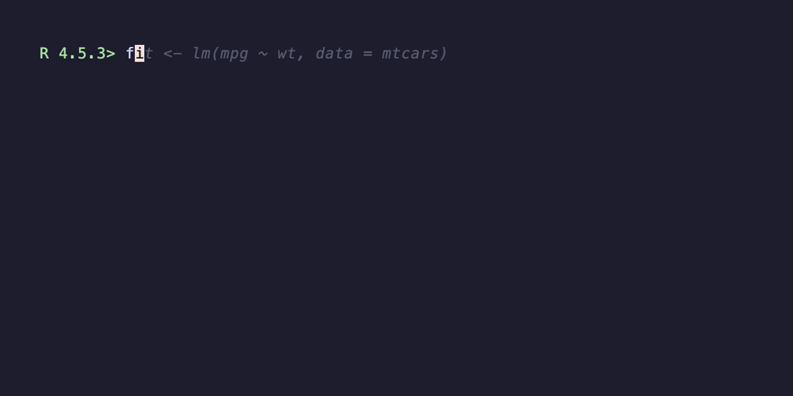
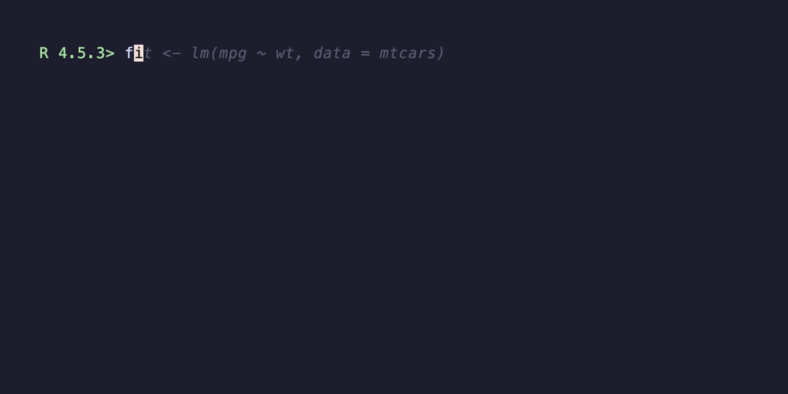

```{r, include = FALSE}
knitr::opts_chunk$set(
  collapse = TRUE,
  comment  = "#>",
  eval     = FALSE
)
```

```{r setup, eval = TRUE}
library(vhsR)
```

A `record_demo()` call with default arguments produces a recording that
*works* — but it can feel mechanical. Every keystroke is the same
length, every line follows the previous with the same beat. Real humans
don't type that way, and a good demo doesn't either. This vignette
walks through the four arguments that change the feel of the recording
without changing the code being demoed.

## The four levers

`record_demo()` exposes four pacing controls:

- **`typing_speed`** — the delay per character. `"60ms"` is the
  default; faster (`"40ms"`) is snappier but reads as urgent, slower
  (`"100ms"`) reads as deliberate.

- **`line_pause`** — the sleep after each line, while output renders.
  Default `"500ms"`. Bump it up for lines whose output you want the
  viewer to read (`summary()`, `str()`); leave it short for setup
  lines.

- **`paragraph_pause`** — *unset by default*. When set, blank lines in
  your expression become a sleep of this duration instead of being
  typed as empty lines. Use it to give viewers a beat between thought
  units.

- **`typing_speed_jitter`** — a number in `[0, 1]`. With jitter, the
  per-line typing speed is sampled uniformly within `±jitter` of
  `typing_speed`. The default `0` means every line types at exactly
  `typing_speed`; `0.3` means each line is somewhere between 70% and
  130% of the base speed. Set `set.seed()` first if you want
  reproducible jitter.

These compose. The recipes below show the difference each makes.

## Side by side

The same five-line demo, recorded three times with different pacing.

### Mechanical: defaults, no jitter, no paragraph beat

```r
record_demo({
  fit <- lm(mpg ~ wt, data = mtcars)

  summary(fit)$coefficients

  predict(fit, newdata = data.frame(wt = c(2, 3, 4)))
}, output = "demo.gif", typing_speed = "60ms")
```


The blank lines come through as empty `Type ""` directives — the
recording moves on the next line immediately, no breathing room.

### Jittered typing speed

```r
set.seed(1)
record_demo({
  fit <- lm(mpg ~ wt, data = mtcars)

  summary(fit)$coefficients

  predict(fit, newdata = data.frame(wt = c(2, 3, 4)))
}, output = "demo.gif",
   typing_speed = "60ms",
   typing_speed_jitter = 0.3)
```



Each line types at a slightly different cadence. The recording reads
less like a TTY playback and more like someone working at the prompt.

### Jittered + paragraph pause

```r
set.seed(1)
record_demo({
  fit <- lm(mpg ~ wt, data = mtcars)

  summary(fit)$coefficients

  predict(fit, newdata = data.frame(wt = c(2, 3, 4)))
}, output = "demo.gif",
   typing_speed = "60ms",
   typing_speed_jitter = 0.3,
   paragraph_pause = "1s",
   line_pause = "600ms")
```



The blank lines now produce a one-second beat instead of being typed
as empty lines. The viewer has time to actually read the
`summary(fit)$coefficients` output before the next block starts.

## A default kit

If you don't want to tune from scratch each time, this is a good
all-purpose starting point:

```r
record_demo(
  ...,
  typing_speed        = "70ms",
  typing_speed_jitter = 0.25,
  line_pause          = "600ms",
  paragraph_pause     = "900ms"
)
```

It's slightly slower than the defaults, has gentle per-line variation,
and treats blank lines as thought beats.

## When the defaults are wrong

- **Dense computational output** (model summaries, large data
  previews): bump `line_pause` to `"1s"` or `"1.5s"` so viewers can
  actually read it.
- **Short snippet** (3–4 lines, on a tight file-size budget): drop
  `typing_speed` to `"40ms"` and skip the jitter — speed wins over
  realism here.
- **Walking through a stepwise tutorial**: `paragraph_pause = "1.5s"`
  and a moderate jitter give viewers time to anticipate each step.

## Reproducibility

`typing_speed_jitter > 0` calls `runif()` once per line. Two
back-to-back recordings at the same jitter value will *look* slightly
different. If your CI workflow re-records as part of release prep and
you want bit-stable retries, call `set.seed()` before
`record_demo()`. The frame timing inside vhs is still inherently
variable (it's a real terminal recording), so "reproducible" here means
content-stable, not byte-stable.

## See also

- `?record_demo` — full argument reference.
- `vignette("recording-for-readme", package = "vhsR")` — where to put
  the GIF once you've recorded it.
- `vignette("tape-scripts", package = "vhsR")` — tape-level pacing for
  when these args aren't enough.
